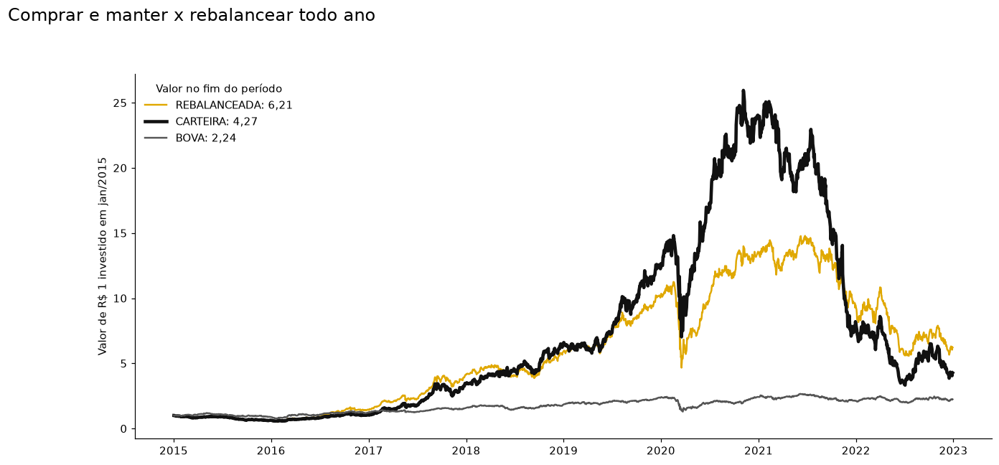

# 📈 Análise do Comportamento de uma Carteira de Ações (2015–2022)

**Escolher ações valeu mais a pena do que investir no índice? Quanto, e por quê?**

<div align="center">

</div>

**Python · Pandas · Análise Financeira · Yahoo Finance · Streamlit · CRISP-DM**

| 📊 Destaques | |
|---|---|
| Período analisado | **8 anos** (jan/2015 a dez/2022), **1.988 pregões** |
| Resultado | R$ 10.000 na carteira viraram **R$ 42.750** (R$ 46.792 com dividendos), contra **R$ 22.419** no BOVA11 e **R$ 19.280** no CDI |
| Crescimento anual | **19,9% ao ano** na carteira x **10,6%** no BOVA11 x **8,6%** no CDI |
| O outro lado | A carteira chegou a **R$ 259 mil** (nov/2020) e caiu para **R$ 33 mil** (jul/2022) |
| Principal descoberta | **85% do resultado veio de 2 ações** (MGLU e WEGE). **Rebalancear todo ano** teria rendido R$ 62 mil, com muito menos risco |
| Entrega | Relatório + tabela de indicadores + **app Streamlit** para simular carteiras + **testes automatizados** |

---

## 📑 Sumário

1. [Contexto do problema](#1-contexto-do-problema)
2. [Objetivo](#2-objetivo)
3. [Base de dados](#3-base-de-dados)
4. [Estrutura do projeto](#4-estrutura-do-projeto)
5. [Como executar](#5-como-executar)
6. [Etapas do projeto (CRISP-DM)](#6-etapas-do-projeto-crisp-dm)
7. [Principais descobertas](#7-principais-descobertas)
8. [Construção da solução](#8-construção-da-solução)
9. [Resultado: carteira x BOVA11](#9-resultado-carteira-x-bova11)
10. [De onde veio o resultado](#10-de-onde-veio-o-resultado)
11. [App interativo (Streamlit)](#11-app-interativo-streamlit)
12. [O que mudou da v1 para a v2](#12-o-que-mudou-da-v1-para-a-v2)
13. [Insights](#13-insights)
14. [Limites](#14-limites)
15. [Próximos passos](#15-próximos-passos)

---

## 1. Contexto do problema

Quem investe em ações precisa saber se as suas escolhas estão **valendo a pena**. A forma mais comum de medir isso é comparar com o **índice do mercado** (Ibovespa): se a carteira rende menos que o índice, seria mais simples e barato comprar um fundo que replica o índice, como o **BOVA11**.

Este projeto analisa uma carteira com **5 ações de setores diferentes** entre 2015 e 2022, um período que inclui a recessão de 2015–2016 e a pandemia de 2020:

| Ação | Empresa (setor) |
|---|---|
| **GOL** | Gol Linhas Aéreas (aviação) |
| **CVC** | CVC Brasil (turismo) |
| **WEGE** | WEG (máquinas e equipamentos elétricos) |
| **MGLU** | Magazine Luiza (varejo) |
| **TOTS** | Totvs (software) |
| **BOVA** | BOVA11: fundo que replica o Ibovespa (**referência**) |

## 2. Objetivo

> **Pergunta de negócio:** *Uma carteira com essas 5 ações, com o mesmo valor investido em cada uma, teria rendido mais do que investir no BOVA11? Quanto, e de onde veio o resultado?*

## 3. Base de dados

Preços de **fechamento diário** de cada ativo, obtidos do **Yahoo Finance** (biblioteca `yfinance`) e salvos em `Datasets/acoes.csv`, para que o resultado seja reproduzível.

| Coluna | Descrição |
|---|---|
| `Date` | Data do pregão (fins de semana e feriados não aparecem) |
| `GOLL4.SA`, `CVCB3.SA`, `WEGE3.SA`, `MGLU3.SA`, `TOTS3.SA`, `BOVA11.SA` | Preço de fechamento (R$) de cada ativo |

Além dos preços de fechamento (`acoes.csv`), o projeto usa:
- `acoes_ajustado.csv`: preço **ajustado por dividendos** (*Adj Close*), também do Yahoo Finance;
- `cdi.csv`: taxa diária do **CDI** (renda fixa), da API do **Banco Central** (série 12 do SGS).

## 4. Estrutura do projeto

```
Analise_do_Comportamento_da_Carteira_de_Acoes-Financas_parte_1/
├── Datasets/
│   ├── acoes.csv                          # preços de fechamento diários (Yahoo Finance)
│   ├── acoes_ajustado.csv                 # preços ajustados por dividendos (Yahoo Finance)
│   ├── cdi.csv                            # taxa diária do CDI (Banco Central)
│   └── indicadores_desempenho.csv         # indicadores calculados (gerado no notebook)
├── Imagens/                               # gráficos gerados pelo notebook
├── Notebooks/
│   ├── Análise do Comportamento da Carteira de Ações - Finanças parte 1.ipynb       # versão original
│   └── Análise do Comportamento da Carteira de Ações - Finanças parte 1 - v2.ipynb  # versão reorganizada (CRISP-DM)
├── src/
│   ├── financas.py                        # retornos, CAGR, Sharpe, maior queda e simulação de carteira
│   └── graficos.py                        # funções de gráficos
├── tests/
│   └── test_financas.py                   # testes automatizados (pytest)
├── app.py                                 # app Streamlit (simulador de carteira)
├── requirements.txt
└── README.md
```

## 5. Como executar

```bash
# 1. Clonar o repositório
git clone https://github.com/RafaelSilva89/Analise_do_Comportamento_da_Carteira_de_Acoes-Financas_parte_1.git
cd Analise_do_Comportamento_da_Carteira_de_Acoes-Financas_parte_1

# 2. Instalar as dependências
pip install -r requirements.txt

# 3. Abrir o notebook
jupyter notebook "Notebooks/Análise do Comportamento da Carteira de Ações - Finanças parte 1 - v2.ipynb"

# 4. Abrir o simulador
streamlit run app.py

# 5. Rodar os testes das funções financeiras
pytest
```

## 6. Etapas do projeto (CRISP-DM)

| Fase | O que foi feito |
|---|---|
| **01. Entendimento do negócio** | Definição da pergunta e dos indicadores |
| **02. Preparação dos dados** | Coleta, conferência da base, análise exploratória com 6 hipóteses e cálculo dos retornos diários |
| **03. Indicadores e carteira** | Comparação de 3 formas de calcular o retorno anual e montagem da carteira |
| **04. Avaliação** | Carteira x BOVA11 x CDI, Índice de Sharpe, janelas de 3 anos e contribuição de cada ação |
| **05. Implantação** | Tabela de indicadores, simulação de R$ 10 mil e app Streamlit |

> ℹ️ Como não há modelo de Machine Learning, a fase de "Modelagem" do CRISP-DM foi adaptada para o **cálculo dos indicadores financeiros**.

## 7. Principais descobertas

**Quanto R$ 1 investido em 2015 virou em cada ação**

<div align="center">

</div>

- **MGLU** multiplicou o valor por **11,8** e **WEGE** por **6,5**. **CVC** e **GOL** terminaram valendo **menos** do que no início (−70% e −51%).

**A pandemia separou vencedores e perdedores**

<div align="center">

</div>

- Em 2020, **CVC (−53%)** e **GOL (−32%)**, que dependem de viagens, despencaram, enquanto **WEGE (+118%)** e **MGLU (+109%)** mais que dobraram.

**A MGLU foi da euforia à queda**

<div align="center">

</div>

- A MGLU chegou a multiplicar o investimento por **118 vezes** (nov/2020) e depois **caiu 90%** desde o pico.

**Mais risco não significa mais retorno**

<div align="center">

</div>

- A **GOL** foi a ação que mais oscilou (77% ao ano) e teve resultado **negativo**. A **WEGE**, com oscilação moderada, teve o 2º melhor resultado.

## 8. Construção da solução

**1️⃣ Normalização**: as ações têm preços muito diferentes (MGLU começou em R$ 0,23; BOVA11 em R$ 47). Para comparar, todas passam a começar em **1**. Assim, o valor final mostra **quantas vezes o dinheiro se multiplicou**.

**2️⃣ Retornos diários**: a variação de cada dia em relação ao anterior. Serve para medir quanto cada ação **oscila** (volatilidade) e para encontrar os dias extremos (todas as maiores quedas aconteceram em março de 2020).

**3️⃣ Como transformar 8 anos em uma taxa anual?** Comparamos três formas:

| Método | GOL (perdeu 51%) | MGLU (subiu 1.077%) |
|---|---|---|
| Média dos retornos diários × 246 *(versão original)* | **+19,6% ao ano** ❌ | +52,3% ao ano |
| Média logarítmica × 246 | −8,8% ao ano | +30,5% ao ano |
| **CAGR – crescimento anual composto** ✅ | **−8,6% ao ano** | **+36,2% ao ano** |

- A média dos retornos diários **superestima** o resultado de ações que oscilam muito. Exemplo simples: subir 10% e cair 10% dá "média 0%", mas R$ 100 → R$ 110 → **R$ 99**.
- O **CAGR** responde exatamente à pergunta do investidor: *"qual taxa fixa por ano levaria meu dinheiro do valor inicial ao final?"*. É o indicador usado em fundos e relatórios de investimento.

**4️⃣ Simulação da carteira**: R$ 2.000 em cada uma das 5 ações no primeiro pregão de 2015, mantidas até o fim de 2022, comparadas com R$ 10.000 no **BOVA11** (mercado de ações) e no **CDI** (renda fixa, sem risco).

**5️⃣ Retorno x risco (Índice de Sharpe)**: quanto de retorno **acima do CDI** cada investimento entregou **para cada unidade de risco**. Quanto maior, melhor.

**6️⃣ Rebalanceamento**: comparamos "comprar e manter" com "no fim de cada ano, redistribuir o dinheiro para voltar a 20% em cada ação".

**7️⃣ Janelas de 3 anos**: para não depender de ter começado exatamente em 2015, calculamos o resultado dos 3 anos seguintes para **cada data de início possível**.

**8️⃣ Testes automatizados**: as funções de cálculo têm testes com `pytest` (ex.: um preço que dobra em 2 anos precisa ter CAGR de ~41,4% ao ano).

## 9. Resultado: carteira x BOVA11

<div align="center">

</div>

| | Carteira | Carteira com dividendos | BOVA11 | CDI |
|---|---|---|---|---|
| **R$ 10.000 viraram** | R$ 42.750 | **R$ 46.792** | R$ 22.419 | R$ 19.280 |
| **Crescimento anual (CAGR)** | 19,9% | **21,3%** | 10,6% | 8,6% |
| **Maior queda (do pico ao fundo)** | −87,2% | −86,8% | −46,9% | 0% |
| **Volatilidade anual** | 45,5% | 45,2% | 26,0% | 0,3% |
| **Índice de Sharpe** | 0,25 | **0,28** | 0,08 | – |

> **Resposta à pergunta de negócio:** **sim**, a carteira rendeu mais que o dobro do BOVA11 e do CDI, mas com um risco muito maior: ela chegou a valer **R$ 259 mil em nov/2020** e caiu para **R$ 33 mil em jul/2022**.

**O momento de entrada importa**

<div align="center">

</div>

- Em janelas de 3 anos, a carteira venceu o BOVA11 em **99%** das datas de início até nov/2018, mas **perdeu em 100%** das datas a partir de jun/2019. Quem começou em nov/2019 perdeu **31% ao ano**.

**Rebalancear todo ano teria sido melhor**

<div align="center">

</div>

| Estratégia | R$ 10.000 viraram | CAGR | Maior queda | Sharpe |
|---|---|---|---|---|
| Comprar e manter | R$ 42.750 | 19,9% | −87,2% | 0,25 |
| **Rebalancear todo ano** | **R$ 62.147** | **25,7%** | **−62,3%** | **0,46** |

- Rebalancear significa **realizar parte do lucro** do que subiu e **reforçar** o que ficou para trás. Assim, a carteira não ficou concentrada na MGLU quando ela despencou.

## 10. De onde veio o resultado

<div align="center">

</div>

- **MGLU (55%)** e **WEGE (30%)** formam **85%** do valor final da carteira.
- **Sem a MGLU**, R$ 10.000 viram R$ 24.014, praticamente o mesmo que o BOVA11 (R$ 22.419).
- **Sem MGLU e sem WEGE**, R$ 10.000 viram apenas **R$ 10.347** em 8 anos.

**Quanto viraram R$ 10.000 em cada opção:**

<div align="center">

</div>

## 11. App interativo (Streamlit)

Um **simulador de carteira** para testar outras combinações:

1. Escolha o **valor investido**, o **período** e o **peso de cada ação**.
2. Opcional: **inclua dividendos** e **rebalanceie todo ano**.
3. Veja o **valor final**, o **CAGR**, o **Índice de Sharpe** e a evolução da carteira comparada ao **BOVA11** e ao **CDI**.

```bash
streamlit run app.py
```

<!-- Adicione aqui um GIF de demonstração do app:  -->

## 12. O que mudou da v1 para a v2

A versão original foi mantida no repositório para mostrar a evolução. Na v2:

| Versão original (v1) | Versão 2 | Por que importa |
|---|---|---|
| Retorno anual = média dos retornos diários × 246 | **CAGR** (crescimento anual composto) | A GOL, que perdeu 51%, aparecia com "+19,6% ao ano" |
| Carteira rendia "24% ao ano" x "13%" do BOVA11 | **19,9%** x **10,6%** ao ano | Mesma conclusão, com os números corretos |
| Desvio padrão do **preço** tratado como risco ("BOVA11 é o mais arriscado") | Risco medido pela **volatilidade dos retornos** | O BOVA11 é, na verdade, o ativo **menos** arriscado |
| Conclusão: "a carteira é melhor que o índice" | Mostra também a **concentração** (MGLU) e a **queda de 87%** | A recomendação muda quando se olha o risco |
| Só o BOVA11 como referência | **BOVA11 e CDI** + **Índice de Sharpe** | Mostra se o risco foi recompensado |
| Sem dividendos | Comparação **com e sem dividendos** | Retorno real do investidor |
| Só "comprar e manter" | Também **rebalanceamento anual** | A estratégia simples que mais melhorou o resultado |
| Resultado de uma única data de início | **Janelas de 3 anos** | Mostra que o resultado depende do momento de entrada |
| Dados baixados da internet a cada execução | Lê os CSVs salvos (download opcional) | Resultado reproduzível |
| Código repetido para cada ação | Funções em `src/` + **testes com pytest** | Código mais limpo, reutilizado no app e testado |

## 13. Insights

1. **A carteira rendeu mais que o índice e a renda fixa**, mas **dependeu de acertar duas ações**: sem a MGLU, empata com o BOVA11.
2. **Rebalancear protege contra a concentração:** rebalanceando todo ano, o resultado seria R$ 62 mil (em vez de R$ 43 mil), com a maior queda reduzida de 87% para 62%.
3. **O momento de entrada importa:** quem começou a partir de meados de 2019 perdeu dinheiro com a carteira em 3 anos.
4. **O CDI foi difícil de bater com segurança:** 8,6% ao ano sem oscilação. O BOVA11 entregou só 2 pontos a mais, com quedas de até 47%.
5. **A forma de calcular importa:** a média dos retornos diários pode mostrar lucro onde houve prejuízo. Para comparar investimentos, use o **CAGR**.
6. **Volatilidade não é sinônimo de retorno:** a GOL, a mais volátil, teve Sharpe negativo; a WEGE teve o melhor Sharpe (0,51).

## 14. Limites

- **GOL sem dividendos:** o ticker GOLL4.SA não está mais disponível no Yahoo Finance, então a GOL usa o preço sem ajuste também na análise com dividendos.
- **Sem custos:** não considera corretagem, impostos nem a taxa de administração do BOVA11 (nem os custos de rebalancear).
- **Viés de retrospectiva:** as ações foram escolhidas olhando para trás. Em 2015, ninguém sabia que MGLU e WEGE iriam disparar.
- **Rentabilidade passada não garante rentabilidade futura.**

## 15. Próximos passos

1. **Aprofundar o risco** (variância, covariância e correlação), feito na **[parte 2](https://github.com/RafaelSilva89/Calculo_do_risco_das_acoes-Financas_parte_2)** deste estudo.
2. **Considerar custos**: corretagem, impostos e taxa de administração.
3. **Atualizar os dados** até a data atual (substituindo o ticker da GOL) e verificar se as conclusões se mantêm.
4. **Testar outras regras de carteira**, como pesos pelo risco.
5. **Publicar o app** no Streamlit Community Cloud e adicionar um GIF de demonstração.

---

📫 **Contato:** [GitHub](https://github.com/RafaelSilva89) · [Portfólio](https://rafaelsilva89.github.io/portfolioProjetos/)
